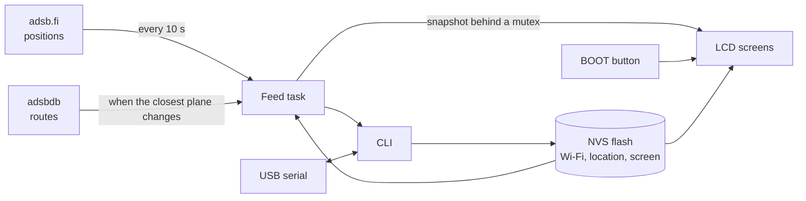

# ESP32C6_PlanesFeed

Firmware for a [Waveshare ESP32-C6-LCD-1.3](https://docs.waveshare.com/ESP32-C6-LCD-1.3) that joins your Wi-Fi and shows the three planes closest to overhead on its 240 x 240 LCD.

The board fetches live aircraft positions from [adsb.fi](https://github.com/adsbfi/opendata) every 10 seconds and looks up the route of the closest plane with [adsbdb](https://www.adsbdb.com/). No computer or API key is needed once it is set up.

## Screens

Each press of the BOOT button moves to the next screen. The last-used screen is restored at power-on.

| Screen | Shows |
|---|---|
| Overhead | The top 3 planes as rows: flight, distance, type, altitude, speed and heading |
| Nearest | The closest plane in detail with its route, then the other two |
| Radar | The top 3 on a 20 km north-up radar |
| Wi-Fi | Connection state, network, IP address, signal and age of the last data |
| Location | Saved coordinates and search radius |

The plane screens say what is missing when Wi-Fi or the location isn't set, and when no planes are nearby. Data older than 30 seconds shows its age in red.

## Design



Two FreeRTOS tasks share the work. A background task does the slow network requests, and the Arduino loop handles the CLI, the button and the display. The feed publishes each result as a complete snapshot, so the screens stay responsive and never draw half-updated data.

**Choosing the planes**
- "Closest" means the smallest horizontal distance from the saved location. Altitude does not affect the order.
- The request asks for 11 nautical miles (20.4 km), because the API takes whole numbers. Results are then cut to 20 km.
- Planes on the ground are skipped.
- Flights are labelled by callsign, then registration, then ICAO hex code, using the first one available.

**Routes**
- Only the closest plane gets a route lookup, and only when that plane changes.
- Routes come from a database keyed by flight number, so they can occasionally be wrong.
- The screen shows "Route unknown" when there is no entry or the lookup fails. A failed lookup is retried on the next cycle.

**Being a good API client**
- The firmware makes one request every 10 seconds, well under the adsb.fi limit of 1 per second.
- It sends nothing until both Wi-Fi and a valid location are set, and the CLI rejects out-of-range coordinates.
- After HTTP 429 it waits 60 seconds before trying again.

**Storage**
Wi-Fi details, location and the current screen are saved in the NVS partition, separate from the firmware, so reflashing keeps them.

### Known limits

- The network must be 2.4 GHz, because the ESP32-C6 has no 5 GHz radio.
- The Wi-Fi password is stored unencrypted in flash, so anyone with physical access to the board could extract it. It is never shown on the LCD or by `status`.
- HTTPS certificates are not verified. The data is public and no credentials are sent, so the worst case is wrong planes on the screen.
- The `huge_app` partition scheme gives 3 MB for firmware and leaves no room for over-the-air updates.
- Wi-Fi power saving is off, because about a quarter of HTTPS connections timed out with it on. The board is expected to run from USB.

### Code layout

| Path | Purpose |
|---|---|
| `firmware/esp32_plane/logic.*` | Distance, sorting, text and CLI parsing, with no hardware dependencies |
| `firmware/esp32_plane/settings.*` | Saved settings in NVS |
| `firmware/esp32_plane/feed.*` | Background task that fetches planes and routes |
| `firmware/esp32_plane/ui.*` | The five screens |
| `firmware/esp32_plane/esp32_plane.ino` | Startup, CLI and button |
| `firmware/esp32_plane/config.h` | Pins, search radius and timings |
| `scripts/provision.py` | Sends `.env` values to the board |
| `test/test_logic.cpp` | Host tests for `logic.*` |

Further detail is in [docs/design.md](docs/design.md), [docs/data-sources.md](docs/data-sources.md) and [docs/board.md](docs/board.md).

## Getting started

You need [`arduino-cli`](https://arduino.github.io/arduino-cli/), `esptool` and Python 3 with `pyserial`. The project was last built with these versions:

| Component | Version |
|---|---|
| Arduino core `esp32:esp32` | 3.3.12 |
| ArduinoJson | 7.4.3 |
| GFX Library for Arduino | 1.6.7 |
| pyserial | 3.5 |

```bash
cp .env.example .env   # then fill in LATITUDE, LONGITUDE, WIFI_SSID and WIFI_PASSWORD
make flash
make setup
```

`.env` is ignored by git. The board keeps the values in flash, so `make setup` only needs to run again when they change.

The serial port defaults to `/dev/ttyACM0`. To use another one, run for example `make flash PORT=/dev/ttyACM1`.

| Command | Purpose |
|---|---|
| `make test` | Run the logic tests on this computer |
| `make firmware` | Build the firmware without flashing |
| `make flash` | Build and flash the firmware |
| `make setup` | Send `.env` values to the board's CLI |
| `make leave-dfu` | Leave download mode and restart the firmware |

## USB serial CLI

The CLI runs at 115200 baud. Quote values that contain spaces.

| Command | Purpose |
|---|---|
| `help` | Show the command list |
| `status` | Show Wi-Fi, location and plane data |
| `wifi <name> [password]` | Save Wi-Fi and connect |
| `wifi clear` | Forget the saved Wi-Fi |
| `location <lat> <lon>` | Save the location in decimal degrees |
| `reboot` | Restart normally |
| `dfu` | Restart into firmware download mode |

The ESP32-C6 has no true USB DFU, so `dfu` uses the chip's serial download mode. The board keeps returning to that mode until the flag is cleared or the power is removed. `make flash` and `make leave-dfu` both clear it.

Serial tools should open the port with DTR and RTS off, because asserting them can reset the chip into download mode. Opening the port also restarts the firmware, so Wi-Fi reconnects each time.

## License

The code is released under the [MIT License](LICENSE).

The license does not cover the data the firmware displays. adsb.fi allows personal, non-commercial use only, and commercial use needs its permission. adsbdb route data may not be copied or republished without permission, so the firmware only shows the current route and stores none of it. See [docs/data-sources.md](docs/data-sources.md).
